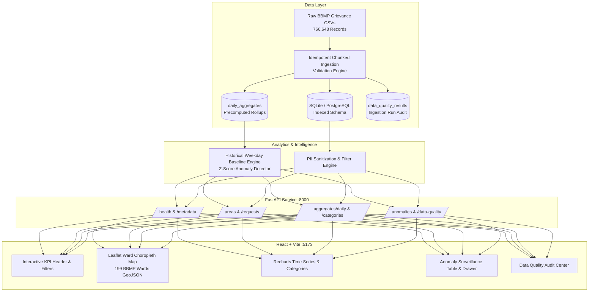

# 🇮🇳 India Civic Disruption Monitoring System
> **Empirical Civic Grievances Analytics, Geospatial Surveillance & Historical Weekday Anomaly Detection**  
> *Bruhat Bengaluru Mahanagara Palike (BBMP), Karnataka, India*

[](https://python.org)
[](https://fastapi.tiangolo.com)
[](https://react.dev)
[](https://leafletjs.com)
[](https://opensource.org/licenses/MIT)
[](https://sqlite.org)

---

## 📌 Executive Summary

The **India Civic Disruption Monitoring System** is a full-stack civic data engineering and analytics platform built on **766,648 official BBMP citizen grievances** across Bengaluru, Karnataka (spanning 2020 through 2025).

Unlike commercial emergency navigation apps or simplistic dashboards, this platform serves municipal urban planners, civil society organizations, and civic researchers by answering five fundamental questions:
1. **Where are reported civic complaints concentrated across Bengaluru?**
2. **Which wards or municipal zones exhibit statistically anomalous spikes in grievance activity?**
3. **How do grievance categories (Solid Waste, Electrical, Roads, SWD) evolve over time?**
4. **What percentage of records have missing, incomplete, or invalid location information?**
5. **What is the true temporal freshness and reporting bias of the underlying civic dataset?**

> ⚠️ **Ethical Disclaimer**: This platform is an *exploratory civic monitoring system*, **NOT** an active emergency dispatch or live navigation service. Complaint volume is an empirical measure of *citizen reporting engagement and portal access*, not conclusive proof that a neighborhood is unsafe or experiencing an emergency.

---

## 🏛️ System Architecture



---

## 🚀 Key Features

### 1. High-Performance, Idempotent Data Ingestion
- **766,648 records ingested** across 6 historical CSV batches.
- **Strict Deduplication:** Guaranteed zero duplicates via primary key conflict handling (`ON CONFLICT DO NOTHING`).
- **Chunked SQLite Batch Insertion:** Batches processed in 60-row parameter windows to strictly respect database bind-variable constraints while maintaining sub-minute execution speeds.
- **Automatic Ingestion Auditing:** Tracks run UUIDs, records read, inserted, skipped, and rejected in `ingestion_runs`.

### 2. Rigorous Data Quality & Schema Validation
- Automated verification of 8 core schema rules:
  - Missing Complaint IDs (0.000% error rate)
  - Date format parsing & chronological boundary validation (0.000% error rate)
  - Future-dated records prevention (0.000% error rate)
  - Missing ward names (0.000% missing; 100% ward coverage)
  - Missing or unexpected grievance statuses
  - Intra-batch and inter-batch duplicate primary keys (0 duplicates)

### 3. Statistically Robust Anomaly Detection
- **Algorithm:** Historical Same-Weekday Rolling Baseline.
- **Formula:**
  $$\mu = \frac{1}{N} \sum_{w=1}^N x_{t - 7w}, \quad \sigma = \sqrt{\frac{1}{N-1} \sum_{w=1}^N (x_{t - 7w} - \mu)^2}$$
  $$Z = \frac{x_t - \mu}{\max(\sigma, 0.5)}$$
- **Protections:**
  - Zero-variance denominator dampener ($\max(\sigma, 0.5)$) prevents asymptotic inflation on low-variance series.
  - Practical significance threshold ($x_t - \mu \ge 3$) eliminates trivial statistical noise (e.g., 0 complaints becoming 1).
  - Lookback excludes the target date and all future records to eliminate target leakage.
- **Categorization:** Classifies events into `NORMAL`, `MODERATE`, `HIGH`, and `CRITICAL SPIKE` with plain-English contextual explanations.

### 4. Interactive Geospatial Dashboard
- **Leaflet Dark-Mode Choropleth:** Ward-level grievance density heat mapping paired with DataMeet's official BBMP Municipal boundaries GeoJSON.
- **Dynamic Anomaly Highlighting:** Wards experiencing active complaint spikes glow with distinct rose/crimson borders.
- **Ward Drill-Down Drawer:** Click any ward to review resolution rates (Resolved vs Pending), category distributions, and daily activity sparklines.
- **Recharts Temporal Trends:** Dynamic day-by-day complaint volume and category breakdown charts.

### 5. Privacy & Ethics by Design
- **Citizen PII Excluded:** Citizen phone numbers, names, and contact details are strictly omitted from database schema and REST responses.
- **BBMP Staff Privacy:** `staff_name` and `staff_remarks` are excluded from all API response models.
- **Transparent Freshness Labeling:** System prominently highlights `HISTORICAL SNAPSHOT (2020–2025)` on the frontend header to prevent misleading live assumptions.

---

## ⚡ Quickstart Guide

### Prerequisites
- Python 3.10+
- Node.js 18+ and npm
- (Optional) PostgreSQL 14+ if deploying to production

### 1. Clone & Set Up Python Environment
```bash
git clone https://github.com/your-org/india-civic-monitor.git
cd india-civic-monitor

# Create virtual environment
python -m venv venv
venv\Scripts\activate      # Windows
# source venv/bin/activate  # macOS / Linux

# Install Python dependencies
pip install -r requirements.txt
```

### 2. Configure Environment Variables
```bash
cp .env.example .env
# Edit .env if you wish to change the dataset directory or database URL
```

### 3. Run Ingestion Pipeline
```bash
# Ingest raw BBMP CSV files and run automated data quality verification
python -m ingestion.ingest
```

### 4. Launch FastAPI Backend
```bash
python -m uvicorn api.main:app --host 127.0.0.1 --port 8000 --reload
```
API Documentation will be available at:
- Swagger UI: [http://127.0.0.1:8000/docs](http://127.0.0.1:8000/docs)
- ReDoc: [http://127.0.0.1:8000/redoc](http://127.0.0.1:8000/redoc)

### 5. Launch React Frontend
In a new terminal window:
```bash
cd frontend
npm install
npm run dev
```
Open [http://localhost:5173](http://localhost:5173) in your browser.

---

## ☁️ Deployment (free)

One-command-ish deploy to **Render's free tier** as a single service (FastAPI
serves the built React dashboard, DB restored from a compressed snapshot at
boot). See **[DEPLOY.md](DEPLOY.md)** for the step-by-step guide.

---

## 🧪 Testing & Verification

Run the full automated test suite:
```bash
pytest -v
```

Run the end-to-end evaluation benchmark:
```bash
python scripts/evaluate_project.py
```
This generates an audit report at `reports/evaluation_report.md`.

---

## 📊 Dataset Profile & Performance

| Metric | Measured Specification |
|---|---|
| **Total Ingested Records** | 766,648 Grievances |
| **Monitored BBMP Wards** | 199 Wards (100% Ward Name Coverage) |
| **Unique Categories** | 19 Distinct Grievance Types |
| **Date Range Covered** | January 1, 2020 – June 19, 2025 (1,958 Days) |
| **Duplicate IDs** | 0 (Deduplication Verified) |
| **Missing Ward Names** | 0 (0.000% Failure Rate) |
| **GPS Point Coordinates** | 0.0% (Aggregated to Ward Choropleth Polygons) |
| **Average Health Latency** | 14.5 ms |
| **Average Daily Aggregate Latency**| 32.9 ms |

---

## 📁 Repository Structure

```text
india-civic-monitor/
├── .env.example                # Sample environment configuration
├── README.md                   # Project overview & quickstart (this file)
├── requirements.txt            # Python dependencies
├── analytics/                  # Statistical anomaly detection algorithms
│   ├── __init__.py
│   └── anomalies.py            # Historical weekday baseline model
├── api/                        # FastAPI REST API application
│   ├── __init__.py
│   ├── main.py                 # Application factory & CORS
│   ├── schemas.py              # Pydantic schemas (PII sanitized)
│   └── routes/                 # Endpoint routers
│       ├── aggregates.py       # Time series & category aggregations
│       ├── anomalies.py        # Anomaly surveillance endpoints
│       ├── areas.py            # Ward statistics & drill-down
│       ├── data_quality.py     # Schema audit & run history
│       ├── health.py           # Health checks & metadata
│       └── requests.py         # Paginated grievances
├── database/                   # Database models & engine configuration
│   ├── __init__.py
│   ├── database.py             # SQLAlchemy session factory
│   └── models.py               # ORM definitions
├── docs/                       # Comprehensive documentation suite
│   ├── API.md                  # Complete REST API specification
│   ├── ARCHITECTURE.md         # Deep technical system design
│   ├── DATA_DICTIONARY.md      # Field definitions & data types
│   └── LIMITATIONS.md          # Bias, ethics, & spatial limitations
├── frontend/                   # React + TypeScript + Vite + Leaflet UI
│   ├── package.json
│   ├── vite.config.ts
│   ├── public/
│   │   └── bbmp_wards.geojson  # Bengaluru municipal boundaries
│   └── src/
│       ├── App.tsx             # Main dashboard controller
│       ├── api.ts              # Backend API client
│       ├── types.ts            # TypeScript interfaces
│       └── components/         # Reusable UI modules
│           ├── AnalyticsCharts.tsx
│           ├── AnomalyTable.tsx
│           ├── AreaDrawer.tsx
│           ├── CivicMap.tsx
│           ├── FilterBar.tsx
│           ├── Footer.tsx
│           ├── Header.tsx
│           ├── OverviewCards.tsx
│           └── QualitySection.tsx
├── ingestion/                  # Data pipeline & validation engine
│   ├── __init__.py
│   ├── ingest.py               # Chunked loader & precomputation
│   └── validation.py           # Schema rules & quality checks
├── reports/                    # Automated evaluation outputs
│   └── evaluation_report.md    # End-to-end benchmark audit
├── scripts/                    # Utility scripts
│   └── evaluate_project.py     # Automated evaluation suite
└── tests/                      # Pytest automated test suite
    ├── __init__.py
    ├── test_api.py             # 15 API endpoint tests
    ├── test_idempotence.py     # Ingestion rerun idempotence test
    └── test_validation.py      # Schema validation logic tests
```

---

## 📜 License & Acknowledgments

- **Dataset Source:** Bruhat Bengaluru Mahanagara Palike (BBMP) Citizen Grievances Portal (Public Municipal Records).
- **Geospatial Boundaries:** DataMeet Municipal Spatial Data (Bengaluru Wards GeoJSON, licensed under CC BY 4.0).
- **Codebase License:** MIT License — Developed as an open-source civic analytics portfolio project.
