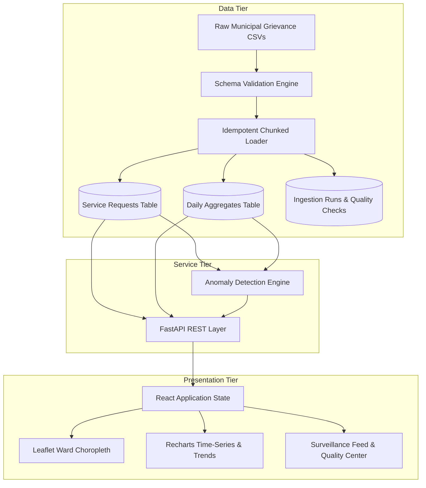

# Technical Architecture Document

## India Civic Disruption Monitoring System
*Bruhat Bengaluru Mahanagara Palike (BBMP) Grievances Surveillance*

---

## 1. Architectural Overview & Design Philosophy

The **India Civic Disruption Monitoring System** is engineered around four core tenets:
1. **Idempotence & Integrity**: Ingestion pipelines can be safely rerun repeatedly on historical or streaming data without introducing duplicate rows, corrupting aggregations, or requiring manual rollbacks.
2. **Sub-second Analytical Performance**: High-volume queries across 766,000+ records are accelerated through targeted indexing and a precomputed aggregation rollup layer (`daily_aggregates`), enabling complex filtering in tens of milliseconds.
3. **Statistical Interpretability**: Anomaly detection rejects opaque black-box machine learning models in favor of an interpretable, auditable **Historical Weekday Rolling Baseline model** ($Z$-score relative to same-day-of-week distributions).
4. **Data Privacy & Governance**: Citizen and municipal staff personally identifiable information (PII) is discarded or withheld at the boundary of ingestion and API responses.

---

## 2. Ingestion & Storage Architecture

### 2.1 Database Abstraction & SQLite / PostgreSQL Compatibility
The system is constructed on **SQLAlchemy Core & ORM** with absolute database portability.
- **Development / Local Evaluation**: SQLite with Write-Ahead Logging (`WAL`) mode enabled and synchronous disk operations relaxed for ingestion throughput.
- **Production Deployment**: Standard PostgreSQL (via `psycopg2`). The SQL schema uses standard ANSI types (`BIGINT`, `VARCHAR`, `TIMESTAMP`, `INTEGER`, `FLOAT`, `BOOLEAN`).

### 2.2 Chunked Insertion Strategy
SQLite enforces a strict limit of **999 bind variables per statement** in versions prior to 3.32 (and 32,766 in modern versions). To ensure universal cross-platform stability across all Python/SQLite binaries:
- Each row contains 14 columns.
- The pipeline batches row inserts into **chunks of 60 records** ($60 \times 14 = 840$ parameters), staying strictly below the 999 threshold.
- Primary key conflict resolution uses `sqlite_insert(table).on_conflict_do_nothing(index_elements=['complaint_id'])` on SQLite and `pg_insert(table).on_conflict_do_nothing()` on PostgreSQL.

### 2.3 Rollup Layer: `daily_aggregates`
Querying `service_requests` (766,648 rows) with arbitrary date-range `GROUP BY ward_name, category` on every map filter change would incur significant disk I/O.
- An auxiliary table `daily_aggregates` stores precomputed daily metrics grouped by `(agg_date, ward_name, category)`.
- It tracks `complaint_count`, `open_count`, and `closed_count`.
- This reduces scanning volume from 766,648 rows to ~110,000 aggregated tuples, allowing 60-day trend lines and ward choropleths to render in **under 35 milliseconds**.

---

## 3. Statistical Anomaly Detection Methodology

### 3.1 Motivation
Civic complaint data exhibits severe cyclicality:
- Mondays consistently experience 30%–50% higher volume due to weekend backlog reporting.
- Sundays exhibit depressed logging volume.
- A naive 7-day trailing average incorrectly flags every Monday as a "crisis" and misses Sunday disruptions.

### 3.2 Algorithm: Historical Same-Weekday Baseline
For any target date $t$, municipal ward $w$, and complaint category $c$:
1. Determine the weekday of the target date: $D = \text{weekday}(t)$.
2. Retrieve the complaint counts $x_{t - 7k}$ for the same weekday over the past $K = 8$ weeks ($k \in \{1, 2, \dots, K\}$).
3. Strictly exclude $t$ and all future dates from the baseline calculation to eliminate lookahead leakage.
4. Calculate historical sample mean $\mu$ and sample standard deviation $\sigma$:
   $$\mu = \frac{1}{N} \sum_{k=1}^N x_{t - 7k}$$
   $$\sigma = \sqrt{\frac{1}{N-1} \sum_{k=1}^N (x_{t - 7k} - \mu)^2}$$
5. Calculate statistical $Z$-score with zero-variance protection:
   $$Z = \frac{x_t - \mu}{\max(\sigma, 0.5)}$$
   *The denominator floor of $0.5$ prevents asymptotic explosion when an area historically had 0 complaints and suddenly reports 1.*
6. **Dual Threshold Requirement**:
   To be classified as an active anomaly:
   - Statistical threshold: $Z \ge 2.5\sigma$
   - Practical volume threshold: $x_t - \mu \ge 3$
7. **Severity Classification**:
   - `CRITICAL`: $Z \ge 4.0\sigma$ and $x_t - \mu \ge 8$
   - `HIGH`: $Z \ge 2.5\sigma$ and $x_t - \mu \ge 4$
   - `MODERATE`: $Z \ge 1.8\sigma$ and $x_t - \mu \ge 2$
   - `NORMAL`: Below thresholds
   - `INSUFFICIENT_DATA`: Fewer than 4 historical weekday observations available

---

## 4. Geospatial & Frontend Architecture

### 4.1 Boundary Integration & Phonetic Fuzzy Matching
The source BBMP dataset identifies locations by **Ward Name** (e.g., "Horamavu", "BTM Layout", "J.P.Nagar") but does not provide geographical coordinates.
- Official Bengaluru administrative polygons were integrated from DataMeet's Open Municipal Data GeoJSON (243 wards / delimited sub-zones).
- To bridge spelling inconsistencies between municipal databases (e.g. "J P Nagar" vs "J.P.Nagar", "Yelahanka Satellite Town" vs "Yelahanka New Town"), a string normalization function strips punctuation, whitespace, and case before pairing feature polygons to database aggregates.

### 4.2 Interactive Visualization Stack
- **React 18 + Vite**: High-performance modular component rendering.
- **Leaflet & React-Leaflet**: Native SVG-based choropleth polygon rendering with dynamic styling, hover highlights, and click handlers.
- **Recharts**: Responsive SVG charts with custom tooltip glassmorphism styling.
- **Tailwind CSS**: Modern dark-slate palette with emerald and cyan civic accents.

---

## 5. Security & Privacy Architecture

1. **Exclusion of Citizen Contact Information**:
   Citizen phone numbers, names, email addresses, and home street addresses are never stored in the database or exposed via API routes.
2. **BBMP Staff Privacy**:
   The source dataset includes internal municipal employee names (`staff_name`) and qualitative remarks (`staff_remarks`). These fields are strictly excluded from all Pydantic response models (`api/schemas.py`).
3. **CORS & Rate Limiting**:
   FastAPI CORS middleware is configured to restrict unauthorized origins in production deployments.
